# DynaCITY — Beirut Urban-Form Forecasting

This branch implements the forecasting portion of DynaCITY Task 5.1. Backcasting and reinforcement learning are deliberately out of scope here.

The engine builds a leakage-safe transition panel from the Beirut Built Environment Database (BBED), including a direct descriptive 2018→2024 interval, optionally enriches the 2022→2024 interval with the post-port-blast 2020 AUB point clouds (photogrammetric reconstructions built in Agisoft Metashape and exported to LAS via PDAL — not laser-scanned LiDAR; see [Point-cloud provenance](#point-cloud-provenance)), benchmarks simple and learned transition models, and produces probabilistic 2-, 4-, or 6-year urban-form KPI forecasts.

## Engineering contribution

The core contribution is a versioned urban-state forecasting boundary that combines:

- BBED status transitions from 2018, 2022, and 2024.
- Static morphology and missing-modality indicators from point clouds.
- Explicit temporal-leakage prevention for the 2020 post-blast point-cloud capture.
- Honest baseline/model selection instead of assuming a graph model is superior.
- Monte Carlo KPI trajectories with p05/p50/p95 uncertainty.
- A shared JSON contract, CLI, and FastAPI service.

BBED polygons remain the canonical building boundaries. Point-cloud-derived watershed instances are useful for detection QA, but attached Beirut buildings cannot be reliably split at party walls from geometry alone.

## Architecture

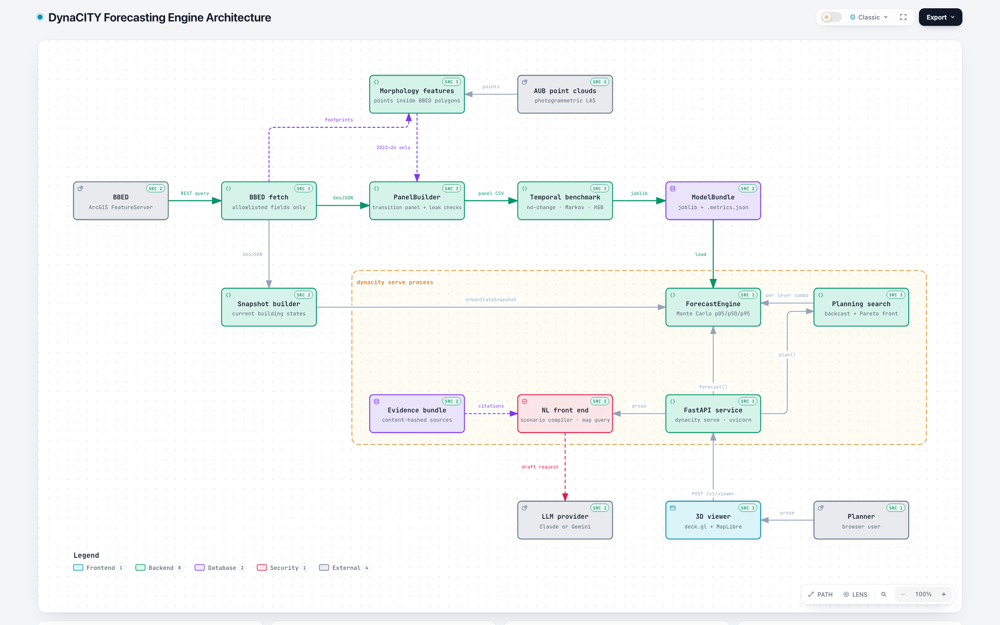

The top two rows are the offline pipeline that trains the model. The boxed region is what `dynacity serve` runs. For an interactive version, download [the diagram](docs/architecture/dynacity-architecture.html) and open it in a browser: every component links to the source lines it was drawn from, pinned to commit `85a52b9`. It was generated with [Archify](https://github.com/tt-a1i/archify) from [this spec](docs/architecture/dynacity-architecture.archify.json), which also validated each citation against the code.

## Screenshots

These come from running the whole pipeline on the public BBED layer (3,349 buildings, snapshot as of 2024-04-30). The benchmark selected the Markov model, and this is the business-as-usual forecast rendered with `dynacity export-viewer`.

| Observed state (2024) | Most likely state in 2 years |
| --- | --- |
| 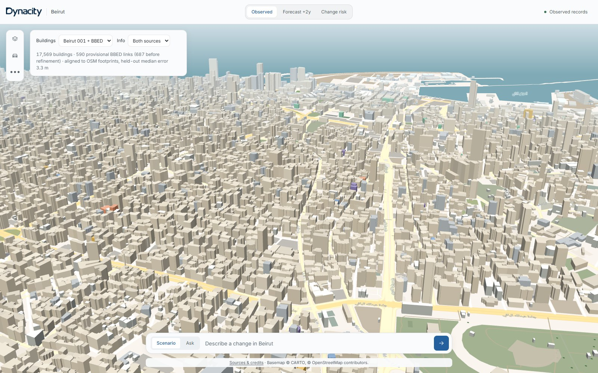 | 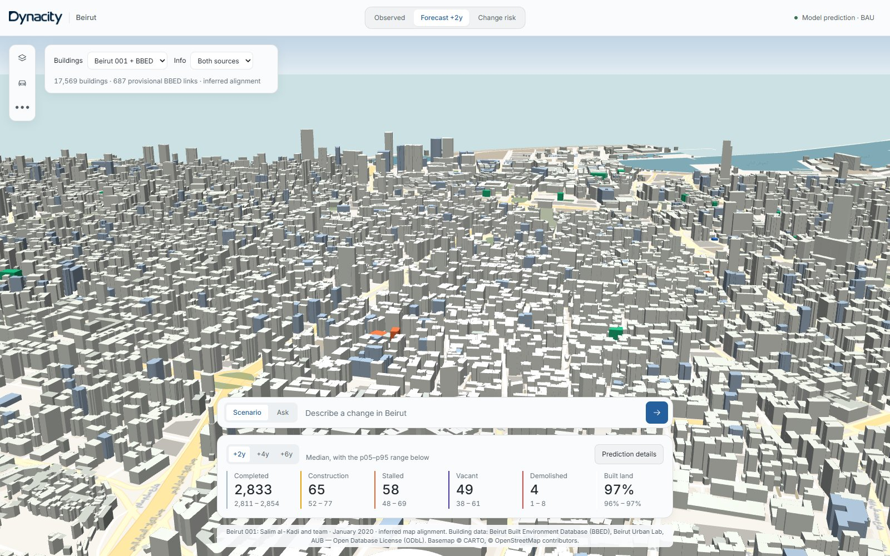 |
| **Chance of leaving the current state** | **All KPIs, p50 with p05–p95 band** |
| 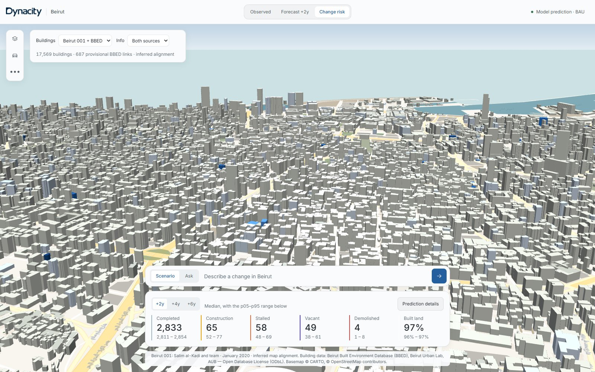 | 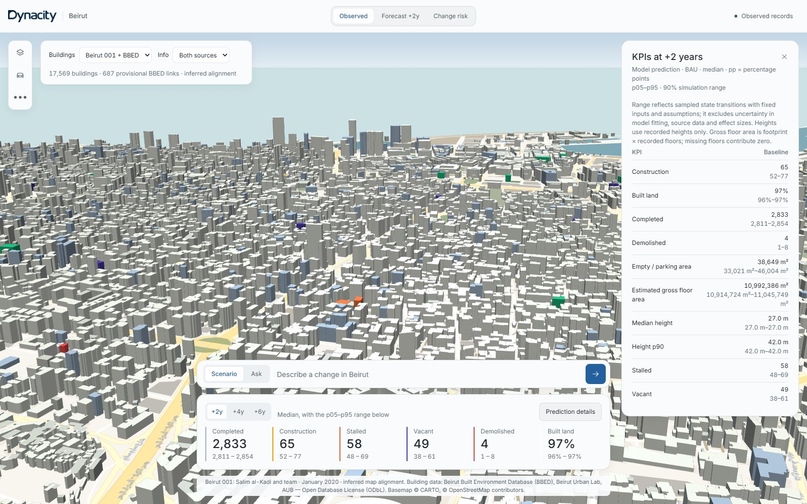 |
| **About this view (provenance and OOD score)** | **HTTP API (`dynacity serve`)** |
| 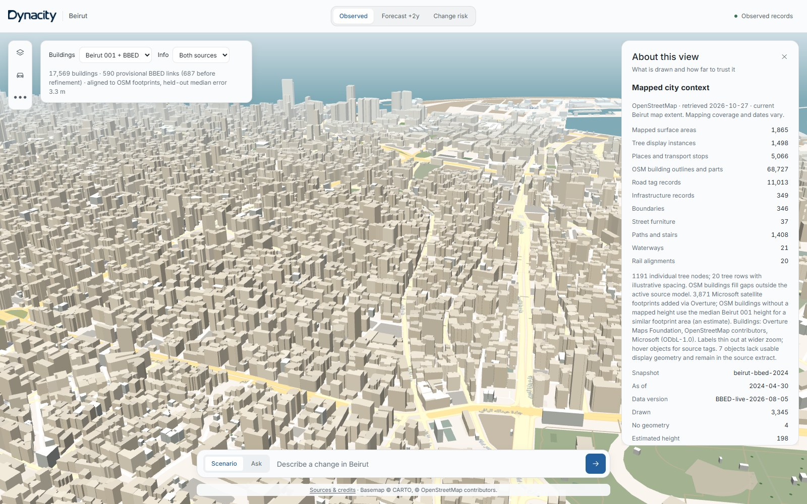 | 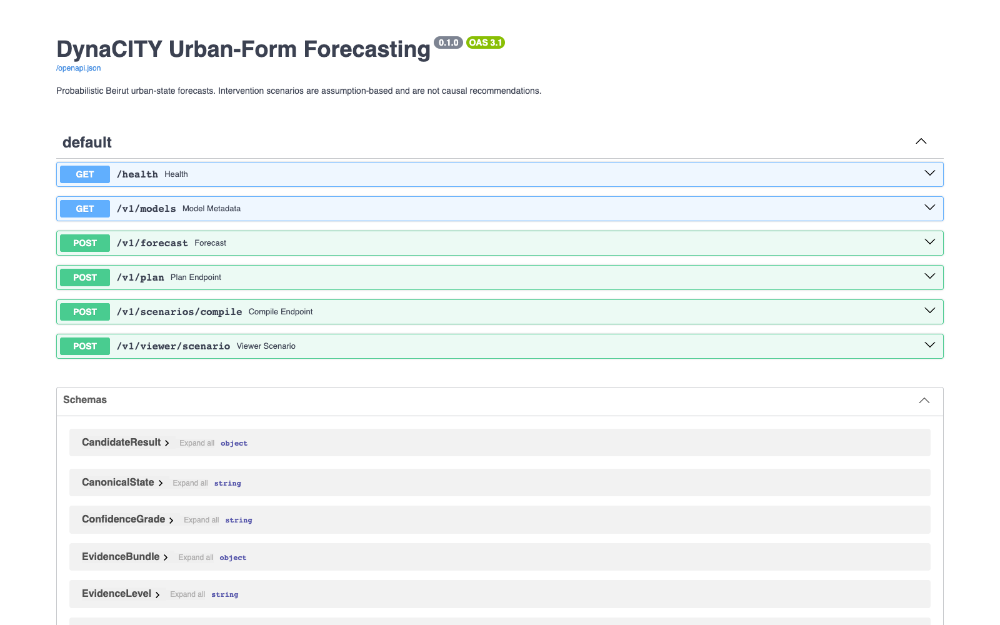 |

### Interactive traffic

The following captures show the local `dynacity serve` viewer. Traffic combines
historical hourly speed profiles with SUMO-generated vehicle trajectories;
these are simulated trips, not live traffic or measured GPS tracks. Road
closures and crashes use illustrative assumptions.

| SUMO traffic playback | Interactive road closure |
| --- | --- |
| 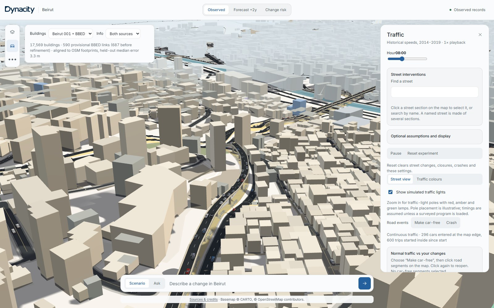 | 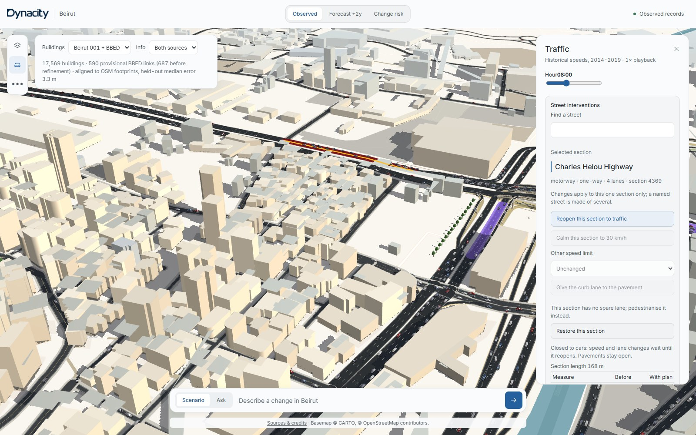 |

**Whole-city buildings.** Run with `--landscape` and `--context-buildings`, the
map also draws about 68,700 mapped building outlines beyond the Beirut 001 and
BBED buildings, from the southern suburbs to east of the Beirut River, at every
zoom. Most of their heights are estimates, not measurements; see
[docs/beirut-context-buildings.md](docs/beirut-context-buildings.md).

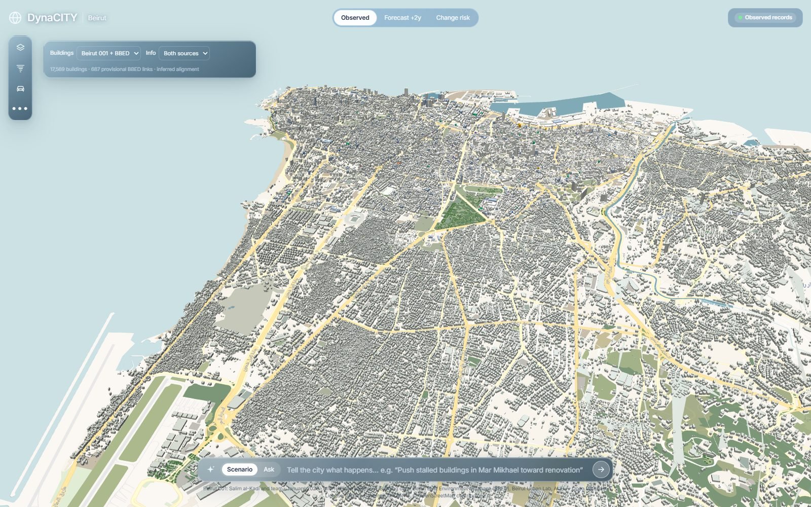

### Video demos

Click an animated preview to open its MP4. These are recordings of the running
viewer; playback speed follows the simulation's on-screen indicator.

[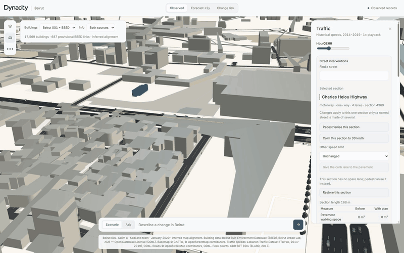](docs/videos/traffic-simulation.mp4)

[Watch traffic playback (MP4)](docs/videos/traffic-simulation.mp4)

## Data sources

| Data | Where it comes from | What we use it for |
| --- | --- | --- |
| Buildings | [Beirut Built Environment Database (BBED), Beirut Urban Lab at AUB](https://beiruturbanlab.com/en/Details/845) | Building footprints, heights, uses and status changes in 2018, 2022 and 2024. |
| Elevation | [Copernicus DEM GLO-30](https://registry.opendata.aws/copernicus-dem/) | Approximate ground elevation for the city view. Resampling does not add street-level detail. |
| Roads and bus routes | [OpenStreetMap](https://www.openstreetmap.org/), downloaded through the [Overpass API](https://overpass-api.de/api/interpreter) | Road layout, lanes, one-way streets, traffic lights, painted crossings, turn restrictions, bridge and tunnel levels, and mapped public transport routes. |
| Buildings beyond BBED and Beirut 001 | [OpenStreetMap](https://www.openstreetmap.org/) outlines and Microsoft machine-learned footprints, both through [Overture Maps](https://overturemaps.org/) (ODbL) | Building outlines across the wider map; heights estimated from Beirut 001 where none is mapped. |
| Historical traffic speeds | [Tari’ak Lebanon Traffic Dataset](https://github.com/ramikay/lebanon-traffic-dataset) | Typical hourly speeds from 2014–2019, rather than live traffic. |
| Traffic counts | [CDR / ELARD BRT study, 2017, Table 4-4](https://documents1.worldbank.org/curated/en/648821508851766209/pdf/SFG3708-EA-P160224-Box405306B-PUBLIC-Disclosed-10-24-2017.pdf) | Peak-hour road counts used to estimate traffic volumes. |
| 3D point clouds | Existing local AlMasar Al Akhdar / AUB project files; no confirmed public download link | Detailed 3D views and surface/ground reviews. See [point-cloud provenance](#point-cloud-provenance). |
| Model buildings and bridge heights | [Beirut 001 3D model by Salim al-Kadi](https://www.salimalkadi.com/07_beirut-001), free Rhino download, January 2020 | Building outlines and heights for an optional map layer, plus measured deck heights for some bridges (evaluated, not used yet). Reduced to a small private pack; see [docs/beirut001-pack.md](docs/beirut001-pack.md). |

Panels, snapshots, trained models, forecasts and planning results are generated locally from these inputs. They are not additional observed datasets. Raw data and generated artifacts stay outside Git, as described below.

## Data coverage

What each dataset actually covers in the current local build. Missing mapping in a source is not evidence that something does not exist on the ground.

**Area.** The building snapshot spans 35.4686–35.5371 E, 33.8620–33.9075 N, about 6.3 km × 5.0 km of central Beirut. Roads and traffic extend 800 m beyond it (35.4598–35.5459 E, 33.8546–33.9149 N), so trips can enter from outside the building area.

| Data | Period or date | Coverage | Gaps |
| --- | --- | --- | --- |
| BBED buildings | Surveys of 2018, 2022 and 2024 | 3,349 buildings in the snapshot; 3,345 have usable footprints | Only the allowlisted fields are fetched; 4 footprints are invalid |
| Roads (OpenStreetMap) | Downloaded 23 October 2026 | 5,570 mapped roads, split into 10,818 road pieces, 809 km | Lane counts are missing on about 6,100 pieces and filled from road-class defaults |
| Traffic lights (OpenStreetMap) | 23 October 2026 | 186 mapped lights, placed at 138 junctions; mid-block lights are dropped | No light timings anywhere; whether lights operate is unknown |
| Painted crossings (OpenStreetMap) | 23 October 2026 | 182 crossing points, placed as 253 crossings on roads | Drawn only; pedestrians are not simulated |
| Turn restrictions (OpenStreetMap) | 23 October 2026 | 42 mapped; 26 applied as banned turns | The 6 that pass through a road rather than a junction are skipped |
| Bridges and tunnels (OpenStreetMap) | 23 October 2026 | 124 bridges and 62 tunnels (135 and 63 road pieces), mainly the motorway flyovers and the Saëb Salam and Corniche underpasses | OpenStreetMap stores no bridge heights; each level is drawn 6 m up |
| Bus routes (OpenStreetMap) | Downloaded 24 July 2026 | 30 route lines | No timetables or stop positions; a route tagged "bus" may be run by vans |
| Traffic speeds (Tari'ak) | 2014–2019 | Hourly median speeds: 5,006 road pieces have their own readings, about 2.9 million readings in total | The other 5,812 pieces use their road class's profile; no live or post-2019 traffic |
| Traffic counts (CDR / ELARD) | 2016–17 | Peak-hour counts by road class at the study's count stations | Not a measured origin-destination matrix; trip patterns are generated |
| Elevation (Copernicus GLO-30) | Global 30 m surface model | Ground height over the snapshot area | Too coarse for street-level detail, kerbs or bridge decks |
| Buildings (Beirut 001) | Model published January 2020 | 17,569 building outlines with heights over about 6.7 × 4.9 km; 687 provisionally linked to BBED footprints | Alignment to BBED is inferred, not surveyed. Heights are measured from the model ground (agrees with GLO-30 to a median 0.4 m) and run a median 5.4 m above BBED's recorded heights. No named licence, so the pack stays private and is served locally only |
| Buildings (OpenStreetMap and Microsoft, through Overture) | OpenStreetMap downloaded 24 October 2026; Overture release 2026-09 | 64,846 OpenStreetMap outlines and 3,871 Microsoft footprints over 35.4693–35.5720 E, 33.8288–33.9076 N | Only about 160 have a mapped height and 110 a floor count. The rest use the median Beirut 001 height for their footprint size; 219 fall back to 6 m. No status or forecast data |
| Bridge heights (Beirut 001) | Model published January 2020 | Usable heights for 31 of the 135 bridge pieces, about 6.6 km of 23.3 km of bridges; their median is 6.1 m, half between about 5 and 9 m | The model has no map position: alignment to BBED is inferred (median 2.8 m off). No named licence, so measured values stay in private data and are not published |

The model's simulated traffic is checked against the Tari'ak speeds; its calibration status is in [docs/traffic-sumo.md](docs/traffic-sumo.md) and [docs/mobility-data-readiness.md](docs/mobility-data-readiness.md).

## Point-cloud provenance

The 2020 point-cloud capture is **photogrammetric (structure-from-motion), not laser-scanned LiDAR**, despite being packaged in `.las` files. Point-level inspection of the source data confirms this: intensity is constant `0` and return number/number-of-returns are always `1` across sampled points — real LiDAR sensors report varying reflectance and, often, multiple returns. The accompanying mesh deliverables carry a glTF `generator` tag of `Agisoft Metashape`, a photogrammetry reconstruction tool; PDAL was used only to export the reconstructed cloud into the `.las` container. Code, CLI flags (`--lidar-features`, `--lidar-year`), and dataframe columns (`lidar_available`, `lidar_acquisition_year`) keep the `lidar` name for continuity with the existing panel/API contract, but functionally they gate on "2020 point-cloud modality available," not on laser LiDAR specifically. The temporal-leakage logic (`panel.assert_no_temporal_leakage`) is unaffected by this distinction — it still correctly forbids the 2020 point-cloud modality from 2018→2022 training rows.

## Private data boundary

Raw LAS/COPC files, BBED downloads, features, trained models, and forecast artifacts are ignored by Git. Set private locations outside the repository:

```powershell
$env:DYNACITY_DATA_ROOT='C:\private\dynacity-data'
$env:DYNACITY_ARTIFACT_ROOT='C:\private\dynacity-artifacts'
```

Only the BBED fields in `dynacity.bbed.BBED_FIELDS` are downloaded. Names, contacts, owner information, and unrelated survey fields are excluded. BBED outputs retain ODbL attribution metadata.

Each object receives a stable composite identity from `BULBuildingID` and ArcGIS `OBJECTID`. This preserves duplicate building IDs and keeps point-cloud features joinable when they were extracted from a spatial subset of the full BBED layer.

## Setup

The recommended environment includes PDAL for safe processing of the multi-gigabyte LAS files:

```powershell
conda env create -f environment.yml
conda activate dynacity-forecasting
```

For the tested lightweight stack:

```powershell
python -m venv .venv
.\.venv\Scripts\Activate.ps1
python -m pip install -e '.[dev]'
```

## Pipeline

1. Inspect LAS metadata without loading the cloud:

   ```powershell
   dynacity inspect-las "C:\path\TheStreetScape.las" --sample-classes 20000
   ```

2. Convert an explicitly hydrated LAS file to COPC. Dry-run first:

   ```powershell
   dynacity build-copc input.las output.copc.laz --dry-run
   dynacity build-copc input.las output.copc.laz
   ```

3. Fetch only the allowlisted BBED fields, optionally limited to a UTM 36N bounding box:

   ```powershell
   dynacity fetch-bbed --bbox 732900 3752900 733400 3753400 --output C:\private\bbed.geojson
   ```

4. Extract BBED-building morphology from the working LAS tile:

   ```powershell
   dynacity extract-features --las TheStreetScape.las --bbed C:\private\bbed.geojson --output C:\private\lidar-features.csv
   ```

5. Build and validate the temporal panel:

   ```powershell
   dynacity build-panel --bbed C:\private\bbed.geojson --lidar-features C:\private\lidar-features.csv --output C:\private\panel.csv
   ```

   The default panel contains 2018→2022 and 2022→2024 modeling rows plus
   direct 2018→2024 rows for descriptive analysis. Generate an auditable summary
   of the direct transition:

   ```powershell
   dynacity summarize-transitions --panel C:\private\panel.csv --start-year 2018 --target-year 2024 --output C:\private\bbed-transitions-2018-2024.json
   ```

6. Run the time-forward benchmark and save the selected model:

   ```powershell
   dynacity train --panel C:\private\panel.csv --output C:\private\forecast.joblib
   ```

7. Build a current snapshot and forecast:

   ```powershell
   dynacity build-snapshot --bbed C:\private\bbed.geojson --snapshot-id beirut-2024 --data-version BBED-2024 --output C:\private\snapshot.json
   dynacity forecast --model C:\private\forecast.joblib --request request.json --output C:\private\forecast.json
   ```

   Or write the scenario in plain language and let the compiler draft and check it. It needs one language-model provider: `pip install -e '.[gemini]'` with `GEMINI_API_KEY` set, or `pip install -e '.[llm]'` with `ANTHROPIC_API_KEY` (pick explicitly with `--provider gemini|anthropic` and `--llm-model`). Keep keys in your environment or keychain, never in the repository:

   ```powershell
   dynacity compile-scenario --snapshot C:\private\snapshot.json --text "Under Law 194/2020, push stalled buildings in Mar Mikhael toward renovation over six years." --output C:\private\compile-report.json --request-output C:\private\request.json
   ```

   Cite curated evidence instead of free text by freezing a registry (see `examples/evidence_registry.example.json`) and passing it to the compiler:

   ```powershell
   dynacity freeze-evidence --registry C:\private\evidence.json --as-of 2024-04-30 --output C:\private\evidence-bundle.json
   dynacity compile-scenario --snapshot C:\private\snapshot.json --text-file scenario.txt --evidence C:\private\evidence-bundle.json --output C:\private\compile-report.json --request-output C:\private\request.json
   ```

8. Backcast and explore trade-offs: give candidate levers, KPI targets, and objectives, and get the least-intervention combinations that meet the targets plus the Pareto front:

   ```powershell
   dynacity plan --model C:\private\forecast.joblib --request plan-request.json --output C:\private\plan.json
   ```

9. Look at it in 3D. Export a static page, or serve it with a live scenario prompt:

   ```powershell
   dynacity export-viewer --bbed C:\private\bbed.geojson --snapshot C:\private\snapshot.json --forecast C:\private\forecast.json --output C:\private-artifacts\viewer.html
   dynacity serve --model C:\private\forecast.joblib --snapshot C:\private\snapshot.json --bbed C:\private\bbed.geojson --evidence C:\private\evidence-bundle.json
   ```

10. Serve the same model through HTTP (`/v1/forecast`, `/v1/plan`, `/v1/scenarios/compile`):

   ```powershell
   dynacity serve --model C:\private\forecast.joblib
   ```

See [the forecasting design](docs/forecasting-engine.md) for the status taxonomy, evaluation gate, API behavior, and limitations.

See [the implementation rationale](docs/implementation-rationale.md) for the full reasoning behind the canonical states, data boundaries, temporal panel, model gate, uncertainty design, interfaces, and current implementation limits.

## Verification

```powershell
pytest
```

The tests use synthetic LAS and BBED fixtures. They do not download or redistribute AUB data.

For repeatable extract, snapshot and panel coverage checks and immutable private
update candidates, see [Data coverage and checked updates](docs/data-coverage.md).
